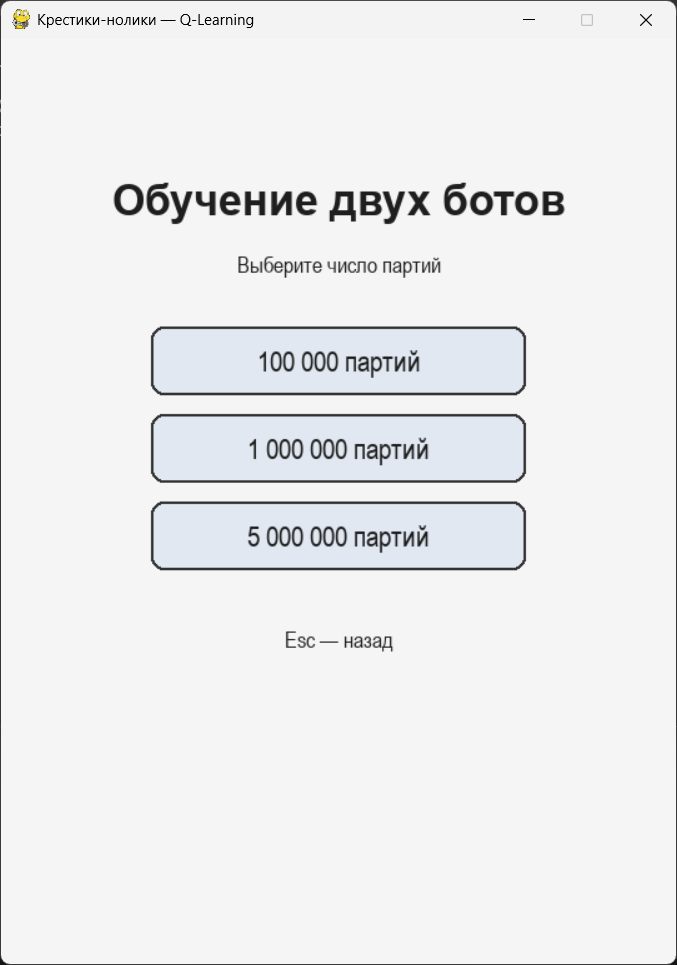
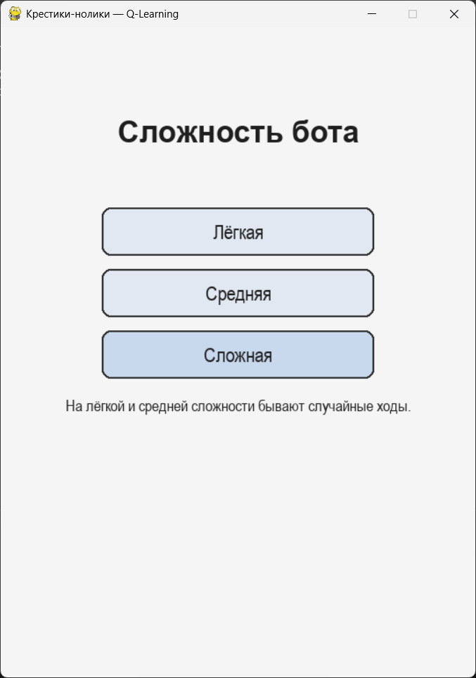
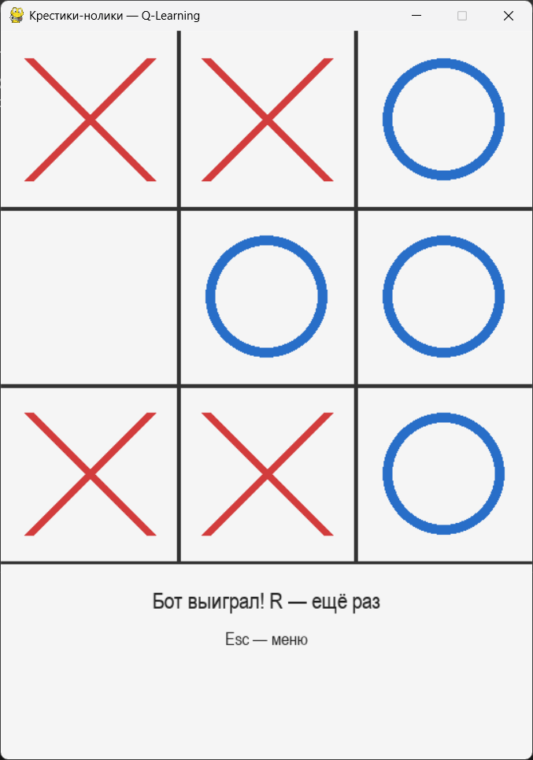
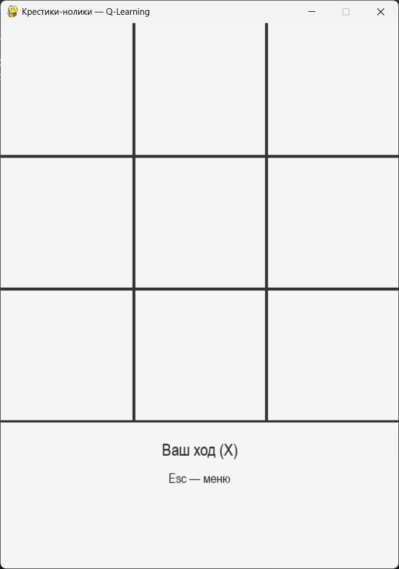

# tic-toe-bot
tic-toe-bot это машина которая играет в крестики нолики обучаясь играя с самим сабой. Это простейшее машинное обучение в виде игры.

# Как его запустить:
1. Скачайте python
2. в терминале введите pip install pygame
3. скачайте gameV3.py
4. в терминале напишите cd "местополежение скаченого файла"
5. потом запустите python gameV3.py

# фото с программы

